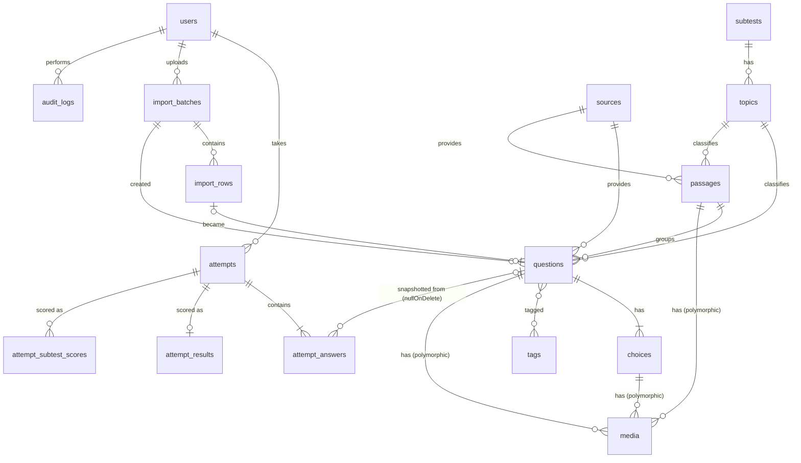

# Plan — CSE Reviewer (MVP)

Status: **approved 2026-10-27** · Implements `spec.md` within `constitution.md` · Decisions trace to `clarifications.md` (R-x, A-x).

## 1. Architecture

### 1.1 Shape
One Laravel app with two front ends that share one domain layer:

```
Browser (user)  ──►  Livewire full-page components + Alpine   ┐
                                                              ├─►  Domain actions/services  ──►  Eloquent  ──►  SQLite (local) / MySQL / PostgreSQL
Browser (admin) ──►  Filament panel at /admin (Livewire)      ┘          (no business logic in components or Filament resources)
```

- **User app:** Livewire full-page components, Blade components and Alpine.js. Alpine handles only presentation: the countdown display, keyboard shortcuts, navigator open/close, the offline banner and theme.
- **Admin:** Filament panel, limited to `role = admin`.
- **Domain:** plain PHP classes in `app/Domain/*`. Livewire components, Filament resources and artisan commands all call the same actions, so the logic is tested once.

### 1.2 Why this stack (challenge check)
| Choice | Why | Alternative rejected |
|---|---|---|
| Livewire + Alpine | The state is server-owned (deadline, answers, scores), so a component that is rendered on the server and backed by actions fits. Filament is built on Livewire, so there is one mental model and one asset pipeline. There is no client-side state store to secure | **Inertia + Vue/React:** stronger offline handling and richer client state, but it means a second stack beside Filament, a JSON API surface to protect, and more code for one developer |
| Filament (admin only) | CRUD, filters, bulk actions, relation managers, forms and dark mode come built in, which saves weeks on the question bank | A custom admin: more control, but much more code for screens only you will use |
| Own `settings` table | About 10 typed settings; a small `Settings` class with a cache is enough | `spatie/laravel-settings`: fine, but one more dependency for very little gain |
| Role enum column plus policies | Two roles now. Adding a role means a new enum case plus policy rules | `spatie/laravel-permission`: worth it only once fine-grained permissions are needed |
| No `leaderboard_entries` table in MVP | Boards are calculated from score snapshots with one indexed query; small data, so it stays correct by construction | A cache table: add it later if the query passes 200 ms. FR-L6 already allows that |

### 1.3 Versions and dependencies
Exact versions are pinned at M1 (O-9, suggestion #5). The rule is the latest stable Laravel, plus the Livewire and Filament majors that are compatible with it.

| Package | Pinned at M1-04 (2026-10-30) | Purpose |
|---|---|---|
| `laravel/framework` | 13.39.0 (`^13.17`) | Core |
| `livewire/livewire` | 4.4.8 (`^4.4.8`) | User app UI (Filament also requires it) |
| `filament/filament` | 5.11.0 (`^5.11`) | Admin panel |
| `pestphp/pest`, `pestphp/pest-plugin-laravel`, `pestphp/pest-plugin-livewire` | 5.3.4, 5.0.1, 5.0.0 | Tests |
| `laravel/pint` (dev) | 1.32.1 | Code style |
| `tailwindcss`, `@tailwindcss/vite`, `@tailwindcss/typography` (npm) | 4.3.3, 4.3.3, 0.5.20 | Styling; typography for passages and explanations |
| `league/commonmark` (comes with Laravel) | via Laravel | Markdown in passages, stems and explanations, with HTML input disabled |

Runtime at pin time: PHP 8.4.26, Composer 2.10.3, Node 26.11.1, npm 11.20.0, Vite 8.3.5. `composer.lock` and `package-lock.json` hold the exact tree. Known: `npm audit` reports a moderate advisory in `postcss-selector-parser` via `@tailwindcss/typography` (build-time only, parses our own CSS); the `--force` fix downgrades typography, so it's accepted until upstream updates.

Skeleton defaults kept as shipped by `laravel new`: `laravel/tinker`, `laravel/pail`, `laravel/pao`, `nunomaduro/collision`, `mockery/mockery`, `fakerphp/faker`, `pestphp/pest-plugin-drift` (composer) and `concurrently`, `laravel-vite-plugin`, `@laravel/multiplex` (npm).

No other packages without a justification line added here.

## 2. Folder structure
```
app/
  Domain/
    Attempts/      StartAttempt, SaveAnswer, ToggleFlag, RevealStudyAnswer, FinalizeAttempt,
                   AbandonAttempt, FinalizeExpiredAttempts, AttemptClock
    Assembly/      TestAssembler, ItemPool, AssemblyRequest, SelectionUnit, ChoiceShuffler
    Scoring/       Scorer, Formulas/GeneralRatingV1, ScoreBreakdown
    Leaderboard/   LeaderboardQuery, Eligibility, Board (enum), Period (enum)
    Content/       PublishQuestion, ArchiveQuestion, DeleteQuestion (with purge), DeleteSource,
                   StemNormalizer, DuplicateDetector, MediaValidator
    Import/        ImportParser (Json/Csv), RowValidator, RowFlagger, CreateImportBatch,
                   ApproveImportRows, RejectImportRows, ImportSchema
    Identity/      RegisterUser, SignInWithUsername, SetPin, RemovePin, LoginThrottle
    Settings/      Settings (typed accessors, cached), SettingKey (enum)
  Enums/           Role, AttemptMode, AttemptTiming, AttemptStatus, QuestionStatus,
                   SourceVisibility, SourceType, Difficulty, Language, NeedsReviewReason
  Models/          User, Subtest, Topic, Source, Passage, Question, Choice, Media, Tag,
                   ImportBatch, ImportRow, Attempt, AttemptAnswer, AttemptResult,
                   AttemptSubtestScore, Setting, AuditLog
  Policies/        QuestionPolicy, PassagePolicy, SourcePolicy, AttemptPolicy, UserPolicy,
                   ImportBatchPolicy, SettingPolicy
  Livewire/        Auth/{Register,SignIn}, Dashboard, Tests/{ConfigureIndividual,ConfigureMock},
                   Attempt/Runner, Results/{Show,Review}, Progress/Index,
                   Leaderboard/Index, Profile/Edit
  Filament/        Resources/{Question,Passage,Source,User,Attempt,ImportBatch,AuditLog}Resource,
                   Pages/{ImportWizard,ExamSettings}, Widgets/ReviewQueue
  Console/Commands CseImport, CseMakeAdmin, CseFinalizeExpired
  Http/Middleware  EnsureUserIsActive
resources/
  views/components/  ui/* (button, card, badge, theme-toggle), question/* (stem, passage, choices,
                     media, data-table), timer, navigator, save-indicator
  views/livewire/    one view per component
  css/app.css        tokens + Tailwind
  js/app.js          Alpine stores: theme, clock, keyboard, offline queue
database/
  migrations/  factories/  seeders/ (TaxonomySeeder, SettingsSeeder, SampleContentSeeder)
content/
  README.md  schema/question-import.schema.json  schema/example.json  schema/example.csv
  inbox/ (gitignored)  staged/  staged/media/
specs/  tests/{Unit,Feature,Arch}
```

## 3. Data model

### 3.1 ERD


### 3.2 Tables (key columns; all have `id` and timestamps unless noted)
| Table | Columns | Indexes and constraints |
|---|---|---|
| `users` | `username` (lowercase), `ign`, `ign_normalized` (lowercase), `full_name`, `email` null, `password` null, `role` (string, default `user`), `is_active` (bool), `pin_set_at` null, `remember_token` | unique `username`, unique `ign_normalized`, unique `email` (nulls allowed on all 3 engines) |
| `subtests` | `code` (`verbal`/`numerical`/`analytical`/`general_info`), `name`, `position` | unique `code` |
| `topics` | `subtest_id`, `code`, `name`, `position` | unique (`subtest_id`, `code`) |
| `sources` | `name`, `type`, `visibility` (default `private`), `notes`, `created_by` | index `visibility` |
| `passages` | `subtest_id`, `topic_id`, `source_id`, `title` null, `body` (markdown) null, `language`, `status` | |
| `questions` | `subtest_id`, `topic_id`, `passage_id` null, `passage_position` null, `source_id`, `import_batch_id` null, `stem` (markdown), `stem_normalized`, `explanation` null, `difficulty` null, `language`, `status`, `needs_review_reasons` (json), `lock_choice_order`, `extraction_confidence` decimal(3,2) null, `source_file`, `source_page`, `source_notes`, `published_at`, `archived_at` | index (`status`, `subtest_id`, `topic_id`); index `source_id`; index `passage_id` |
| `choices` | `question_id` (cascade), `position`, `body`, `is_correct` | unique (`question_id`, `position`) |
| `tags`, `question_tag` | `name` (unique) / pivot | |
| `media` | `mediable_type`, `mediable_id`, `disk`, `path`, `mime`, `size`, `width`, `height`, `alt_text`, `position` | index on the morph pair |
| `import_batches` | `user_id`, `original_filename`, `format`, `default_source_id`, `status`, `total_rows`, `valid_rows`, `approved_rows`, `rejected_rows` | |
| `import_rows` | `import_batch_id` (cascade), `row_number`, `payload` (json), `errors` (json), `flags` (json), `duplicate_of_question_id` null, `decision` (`pending`/`approved`/`rejected`), `question_id` null | index (`import_batch_id`, `decision`) |
| `attempts` | `user_id` (cascade), `mode`, `timing`, `subtest_id` null, `topic_ids` (json) null, `item_count`, `config` (json: split, minutes, passing grade, grace, thresholds at creation), `is_standard` (bool), `is_partial`, `has_private_items`, `status`, `started_at`, `deadline_at` null, `finalized_at` null, `time_used_seconds` null, `current_position`, `seed`, `is_suspicious`, `hidden_at` null, `hidden_by` null, `hidden_reason` null | index (`user_id`, `status`); index (`mode`, `status`, `finalized_at`) |
| `attempt_answers` | `attempt_id` (cascade), `question_id` null (**nullOnDelete**), `position`, `subtest_id`, `topic_id`, `passage_key` null, `snapshot` (json), `correct_key`, `selected_key` null, `is_correct` null, `flagged`, `answered_at` null, `revealed_at` null, `purged_at` null | unique (`attempt_id`, `position`); index (`question_id`); index (`topic_id`, `is_correct`) |
| `attempt_results` | `attempt_id` (unique, cascade), `formula_version`, `general_rating` decimal(5,2), `passing_grade` decimal(5,2), `passed`, `correct_count`, `total_count`, `time_used_seconds`, `end_reason`, `topic_breakdown` (json) | index (`general_rating`) |
| `attempt_subtest_scores` | `attempt_id` (cascade), `subtest_id`, `correct`, `total`, `percent` decimal(5,2) | unique (`attempt_id`, `subtest_id`); index (`subtest_id`, `percent`) |
| `settings` | `key` (unique), `value` (json), `updated_by` null | |
| `audit_logs` | `user_id` null, `action`, `subject_type`, `subject_id`, `reason` null, `meta` (json), `created_at` | index on the subject pair |

Notes:
- The **snapshot** json holds `stem`, `passage` (`body`, `media[]`), `choices[]` in the shown order (`key` A–E, `body`, `media[]`), `explanation`, `source_visibility`, and `question_updated_at`. `correct_key` sits in its own column so scoring never parses JSON.
- Media files referenced by snapshots are **copied paths**. Deleting a question deletes its `media` rows, but files still referenced by a snapshot are kept unless the delete purges them (FR-Q5a), in which case they are removed too.
- **Has PIN** = `role = user AND password IS NOT NULL`. `pin_set_at` exists for display and auditing.
- **One in-progress attempt per user** (A-7) is enforced in `StartAttempt` inside a transaction that locks the user row (`lockForUpdate`). A partial unique index isn't portable to MySQL.
- **Portability:** no engine-specific column types; JSON columns are read and written only through casts and **never filtered on in SQL** (filters use real columns); booleans are real booleans; decimals are used for scores; the only raw SQL is the `ROW_NUMBER() OVER (...)` window in `LeaderboardQuery`, which is standard SQL supported by SQLite 3.25+, MySQL 8 and PostgreSQL. An arch test enforces this (see §10).

## 4. Key user-facing Livewire components
| Component | Route | Responsibility |
|---|---|---|
| `Auth\Register` | `/start` | Username, IGN, full name, optional PIN → `RegisterUser`. Shows the privacy summary |
| `Auth\SignIn` | `/login` | Username plus a PIN if one is set. Throttled using settings values |
| `Dashboard` | `/` (auth) | Card to resume the in-progress attempt, start buttons, last 5 results, PIN nudge |
| `Tests\ConfigureIndividual` | `/practice` | Subtest, topics, count, timing (`timed`/`untimed`/`study`); shows the available count and duration preview; → `StartAttempt` |
| `Tests\ConfigureMock` | `/mock` | Timed or untimed; shows the split (marked unverified) and availability; partial-mock warning |
| `Attempt\Runner` | `/attempts/{attempt}` | **Core runner** (see 4.1) |
| `Results\Show` | `/attempts/{attempt}/results` | GR, pass/fail, subtest and topic tables, time used, eligibility status ("Not on leaderboard: set a PIN" etc.) |
| `Results\Review` | `/attempts/{attempt}/review` | Snapshot-based review, filters as `#[Url]` query parameters, paginated by 20 |
| `Progress\Index` | `/progress` | History, accuracy per topic (aggregated from `attempt_answers`) |
| `Leaderboard\Index` | `/leaderboard` | Board and period as `#[Url]` parameters; IGN, score, time; public (no auth required) |
| `Profile\Edit` | `/profile` | IGN (read-only for users; admins change it), set/change/remove PIN, theme |

### 4.1 `Attempt\Runner` design
- **Public state is minimal and locked:** `#[Locked] public int $attemptId`, `public int $position`. Questions, the snapshot and the answer key are **never public properties**, because Livewire sends public state to the browser. The current item is a `#[Computed]` value rendered on the server, and `correct_key` is not in the rendered HTML unless it may be revealed. In study mode, `select()` sets `selected_key`, `answered_at` and `revealed_at` in one step, and the view renders the key and explanation only for items whose `revealed_at` is set. After finalization every item may be shown. AC-10a checks the HTML and the Livewire payload directly.
- **Actions:** `select(string $key)`, `toggleFlag()`, `goTo(int $position)`, `next()`, `prev()`, `submit()`, `timeUp()`, `reveal()` (study mode). Each one authorizes through `AttemptPolicy@update`, then calls `AttemptClock::guard()` (lazy finalization), then the domain action.
- **Navigator data:** one lightweight array (`position`, `answered`, `flagged`, `subtest`) per item. This is safe to expose because it has no content and no keys.
- **Autosave:** `select()` stores the answer immediately. Alpine updates the UI optimistically and shows the save indicator. Calls go through a small **Alpine queue**: pending answers wait in `localStorage` (`attempt:{id}:pending`) and are retried with backoff after a failure; the offline banner shows while the queue is non-empty and the network is down. On load, any pending stash is replayed and the server decides whether each answer is still accepted.
- **Keyboard:** an Alpine `keyboard` store binds `1–5`/`A–E`, `←/→`, `F`, `N`, but only when focus is not in a text input. The choices are a native `<fieldset>` with radio inputs, so screen readers work without custom ARIA.
- **Passage layout:** two columns at `lg` and wider (passage pane scrolls on its own), stacked on smaller screens. Tables are wrapped in `overflow-x-auto` with `role="region"` and a label.

## 5. Server-authoritative timer
**Stored:** `started_at`, `deadline_at = started_at + duration` (set by `StartAttempt` from the attempt's `config`), and `config.grace_seconds`.

**Server rules (`AttemptClock`)**
1. `remainingMs(attempt)` = `max(0, deadline_at − now)`, in server time.
2. `guard(attempt)`: if the attempt is timed, in progress and `now > deadline_at + grace`, call `FinalizeAttempt(timeout)` and stop the action (the component redirects to results).
3. `SaveAnswer` accepts a change only if the attempt is in progress and `now ≤ deadline_at + grace`.
4. `timeUp()` from the client finalizes only if `now ≥ deadline_at`. An early call is ignored and the correct remaining time is sent back.
5. **Lazy sweep:** `Dashboard`, `Runner` mount and sign-in call `FinalizeExpiredAttempts::forUser()`.
6. **Optional global sweep:** `cse:finalize-expired`, scheduled every minute (it runs if `php artisan schedule:work` is running; not required locally because of rule 5).

**Finalization (`FinalizeAttempt`)** runs in `DB::transaction` and calls `Attempt::lockForUpdate()->find()`. If the status is no longer `in_progress`, it returns the existing result (this makes it idempotent, covering AC-8). Otherwise it scores the attempt, writes `attempt_results` and `attempt_subtest_scores`, sets `status`, `finalized_at` and `time_used_seconds = min(finalized_at, deadline_at) − started_at`, and sets `is_suspicious` from the `config` threshold.

**Client display (Alpine `clock` store):** every Livewire response includes `remainingMs`. The client sets `localDeadline = performance.now() + remainingMs`, so a wrong device clock doesn't matter, and renders `mm:ss` once per second. It makes polite live-region announcements only at 10 and 1 minutes, and calls `$wire.timeUp()` at 0. A `wire:poll.60s` keep-alive resyncs the remaining time. Untimed attempts show elapsed time only.

## 6. Test assembly
`TestAssembler::assemble(AssemblyRequest)` returns an ordered list of selection units, using a seeded `Random\Randomizer` (seed stored on the attempt, so tests are reproducible).
1. **Pool:** published questions in the requested subtest(s) and topics. Private sources are included only if the user is an admin.
2. **Units:** a standalone question is a unit of size 1. A passage is one unit of size *k*, using its published questions in `passage_position` order.
3. **Avoid repeats:** split the pool into *fresh* (not in the user's last N attempts) and *seen* (ordered by when last seen, oldest first). Draw from fresh first.
4. **Quotas:** combined mode uses the subtest counts from settings. Within a subtest, the count is divided evenly across topics (the remainder goes to the first topics by `position`), and a shortfall is filled from other topics in the same subtest (A-3). Individual mode applies the even split across the selected topics.
5. **Fitting passages:** a unit is chosen only if its size ≤ the remaining quota. If a quota can't be filled exactly, smaller units are tried. If it still can't be filled, the shortfall is reported, which leads to the partial-test path (FR-G7).
6. **Order:** subtests in fixed order, units shuffled within each subtest, with passage items kept together.
7. **Choices:** shuffled per question unless `lock_choice_order` is set, and labeled A–E in the shown order.
8. `StartAttempt` writes the attempt and all `attempt_answers` with snapshots in **one transaction**, and sets `has_private_items`, `is_partial` and `is_standard`.

## 7. Scoring and leaderboard
- `Scorer` runs **formula `v1`**: `GR = round(correct × 100 / total, 2)` (PHP `round` is half-up, A-5), and the same for each subtest and topic. `passed = GR ≥ config.passing_grade`, compared as integer hundredths to avoid float error (8000 ≥ 8000). The formula version is stored. A future `v2` is a new class plus a registry entry, and old results keep `v1`.
- `Eligibility` is a query scope used both by the board and by the "why not ranked" messages. Its conditions (FR-L2): status in (`submitted`, `timeout`), `timing = timed` (so `untimed` and `study` never count, AC-16c), `is_standard`, not `is_partial`, `hidden_at IS NULL`, the user is active and (has a PIN or is an admin), and (`has_private_items = false` OR the `leaderboard_include_private` setting is ON). The setting is read at query time.
- `LeaderboardQuery`:
  - The full-mock board joins `attempt_results`.
  - Subtest boards join `attempt_subtest_scores` on individual attempts of that subtest.
  - An inner `ROW_NUMBER() OVER (PARTITION BY user_id ORDER BY score DESC, time_used ASC, finalized_at ASC)` keeps each user's best attempt, and the outer query orders and paginates.
  - The weekly period filters `finalized_at` between Monday 00:00 and next Monday 00:00 Asia/Manila, converted to UTC.
  - It selects only `ign`, never `full_name`, and an arch test checks this.

## 8. Import pipeline
### 8.1 Flow
```
content/inbox/<subtest>/<topic>/raw files   (gitignored, yours)
        │  Claude extracts: OCR/reading, structure, provenance, confidence. Never guesses keys.
        ▼
content/staged/<batch-name>.json (+ staged/media/*)   (gitignored)
        │  php artisan cse:import content/staged/x.json [--dry-run]     or  Filament ImportWizard (JSON/CSV upload)
        ▼
ImportParser → RowValidator → RowFlagger (missing key/explanation, low confidence, media, duplicates)
        ▼
import_batches + import_rows (pending)  ──►  Filament ImportWizard: preview, row errors, flags, duplicate links
        │  approve rows (valid only) / reject rows
        ▼
ApproveImportRows (transaction): source (default private), passage, question, choices, media, tags
        → status draft, or needs_review with reasons
        ▼
Admin edits/resolves → PublishQuestion (blocked while reasons or missing alt text remain) → published
```

### 8.2 JSON format (`content/schema/question-import.schema.json`, version 1)
```json
{
  "schema_version": 1,
  "batch": { "name": "reviewer-x-numerical-p1-20", "default_source": { "name": "Reviewer X (2024)", "type": "reviewer", "visibility": "private" } },
  "passages": [
    { "ref": "p1", "subtest": "verbal", "topic": "reading_comprehension", "language": "en",
      "body": "Markdown text…", "media": [{ "path": "media/p1-chart.png", "alt": "Bar chart of …" }] }
  ],
  "items": [
    { "subtest": "numerical", "topic": "number_sequences", "passage_ref": null, "language": "en",
      "stem": "What comes next: 2, 6, 12, 20, __?",
      "choices": ["28", "30", "32", "36"], "answer": "B",
      "explanation": "Differences increase by 2: 4, 6, 8, 10 → 30.",
      "difficulty": "easy", "tags": ["differences"], "lock_choice_order": false, "media": [],
      "provenance": { "file": "reviewer-x.pdf", "page": 12, "notes": "" },
      "extraction": { "confidence": 0.95, "needs_review": false, "notes": "" } }
  ]
}
```
- `answer` can be a letter matching the choice order, or `null` → flagged "missing answer key". `explanation: null` → flagged.
- `media.path` is relative to `content/staged/`. The CLI reads files from disk. **Filament upload is JSON/CSV only**; rows that reference media are imported with the flag "media missing — attach in editor" (zip upload is suggestion #14).
- **CSV** (standalone items only): `subtest,topic,language,stem,choice_a,choice_b,choice_c,choice_d,choice_e,answer,explanation,difficulty,tags,source_file,source_page,notes,confidence`. `tags` is separated by `|`.

### 8.3 Validation and flags
- **Errors** (row can't be approved): unknown subtest or topic, empty stem, fewer than 2 or more than 5 choices, an `answer` that doesn't match a choice, a missing `passage_ref`, unsupported media type or size (PNG/JPG/WebP checked by `finfo` MIME, ≤ 2 MB), duplicate `ref`.
- **Flags** (row imports as `needs_review`): `missing_answer_key`, `missing_explanation`, `low_confidence` (< 0.8), `media_missing`, `missing_alt_text`, `possible_duplicate` (with `duplicate_of_question_id`), `extractor_flagged`.
- `DuplicateDetector` normalizes the stem (`StemNormalizer`: lowercase, strip punctuation, collapse whitespace), finds candidates in the same subtest whose length is within ±30%, and computes similarity in PHP (`similar_text` percent). Anything at or above the threshold setting is flagged. Rows within the same batch are compared against each other too.
- `content/README.md` (the first M3 task) documents file naming (`<subtest>/<topic>/<source-slug>_p<page>.<ext>`), what to include (answer keys and explanation pages), and what Claude does with each type of file.

## 9. Theming and UI
- **Tailwind dark mode by class:** `@custom-variant dark (&:where(.dark, .dark *));` in `app.css` (Tailwind v4 syntax; adjust if M1 resolves to v3).
- **No flash:** the server reads the `theme` cookie (`light|dark|system`) and renders `<html class="dark">` when it's explicitly dark. A blocking inline `<script>` in `<head>` (before CSS) handles `system` through `matchMedia`, and keeps listening for OS changes while the preference is `system`. The toggle writes both localStorage and the cookie. Both apps share Filament's localStorage key `filament:theme:mode` (verified in M1-13; Filament 5 does not use `theme`), so they follow one choice. localStorage is the source of truth; the inline script re-syncs the cookie on every page, so a change made in the admin panel reaches the server on the next user-app request.
- **Tokens** (CSS variables on `:root` and `.dark`): `--bg`, `--surface`, `--fg`, `--muted`, `--border`, `--accent`, `--accent-fg`, `--danger`, `--success`, `--focus`. One accent color (proposed: **indigo**, `#4f46e5` light / `#818cf8` dark). An M7 test checks every token pair against AA.
- **Typography:** system font stack, 16–18 px body, line length ≤ 70 characters for passages, `font-variant-numeric: tabular-nums` for the timer and scores.
- **Motion:** only transitions under 150 ms, and none when `prefers-reduced-motion` is set.
- **Filament:** `->colors(['primary' => Color::Indigo])`, dark mode on.

## 10. Roles and permissions
- `App\Enums\Role`: `Admin`, `User`, stored as a string in `users.role`. `User::hasRole()` and `isAdmin()`.
- **Single `web` guard, two sign-in paths:**
  - `/login` (Livewire): username plus a PIN if `password` is set. Only `role = user` can sign in here.
  - `/admin/login` (Filament): email plus password. `User::canAccessPanel()` returns true only for active admins.
- **Policies** for every model. Admin rights come from policy methods such as `QuestionPolicy::viewAny => isAdmin()`, never from `Gate::before`, so a future role (for example `editor`, who can edit questions but not users) only changes the relevant policies.
- `AttemptPolicy`: the owner can view and update their own attempt. Admins can view any attempt and moderate. Nobody can update a finalized attempt.
- `EnsureUserIsActive` middleware logs out deactivated users.
- **Throttle:** `LoginThrottle` uses `RateLimiter` with the key `login:{username}|{ip}` and the limits from settings.
- **First admin:** `php artisan cse:make-admin` asks for email, username, IGN, full name and password (A-18). The password uses Laravel's `Password::defaults()` (min 8 characters), chosen in M1-12.
- **Audit log:** publish, archive, delete (with or without purge), leaderboard hide/unhide, role change, PIN reset and settings change.

## 11. Testing strategy
| Layer | Tool | Covers |
|---|---|---|
| Unit | Pest | `Scorer` (80.00 boundary, rounding, empty subtests), `AttemptClock` (grace, early `timeUp`), `TestAssembler` (quotas, passages kept together, repeat avoidance, shortfall, seeded determinism), `ChoiceShuffler` (lock order), `StemNormalizer` and `DuplicateDetector`, `RowValidator` and `RowFlagger`, `MediaValidator`, `Eligibility` |
| Feature | Pest + `Livewire::test()` | Each acceptance criterion as `it('AC-13: …')`: registration and sign-in, runner actions, double submit, timeout, refresh/resume, study reveal, results and review from snapshots after edit or delete or purge, leaderboard rules and setting toggle, full-name absence |
| Admin | Pest + Filament Livewire tests | Resources render for admins and return 403 for users, publish gating, typed-delete confirmation, ImportWizard approve/reject, settings validation, hide with reason |
| Command | Pest `artisan()` | `cse:import` (dry run, errors, flags), `cse:make-admin`, `cse:finalize-expired` |
| Architecture | Pest `arch()` | No `DB::raw`/`selectRaw`/`whereRaw` outside `LeaderboardQuery`; no `env()` outside `config/`; Livewire components and Filament resources don't call models' write methods directly (they go through Domain); no `full_name` in `Leaderboard*`; no `dd`/`dump` |
| Concurrency | Pest | Double-finalize simulation (call twice, assert one result); the transaction-based one-active-attempt guard |
| Accessibility and UI | Manual checklist in M7 (keyboard-only run, screen reader spot check, 320 px, contrast test on tokens); Pest browser tests if the plugin is compatible at M7 | Keyboard flow, no theme flash, focus management |

- **Time:** `$this->travelTo()` and `Carbon::setTestNow()`. Randomness: a fixed seed in `AssemblyRequest`.
- **Data:** factories for every model, with states (`published()`, `private()`, `inPassage()`, `timedMock()`, `finalized(score)`).
- **DB:** SQLite in memory. Portability is enforced by the arch tests, and the full suite runs once on MySQL and once on PostgreSQL in M7 before any deploy (#15).
- **Done means:** tests green, `pint --test` clean, the task box ticked in `tasks.md`.

## 12. Security checklist
- The answer key never reaches the client before it may be revealed (§4.1). An M4 test asserts the rendered HTML of an in-progress item has no `correct_key` value.
- `#[Locked]` on IDs. Every action is authorized. Mass assignment uses `$fillable`.
- Markdown is rendered with `html_input: strip` and `allow_unsafe_links: false`.
- Uploads: MIME checked by `finfo`, extension whitelist, 2 MB cap, random file names, stored on the `public` disk under `media/`.
- PIN and password use the `hashed` cast (bcrypt). Sign-in is throttled. The session is regenerated on login.

## 13. Milestone outline (detail in `tasks.md`)
| Milestone | Delivers |
|---|---|
| M1 | Herd, Laravel scaffold, git, Pest/Pint, versions pinned, roles, user sign-in with PIN, admin sign-in, theming, settings table, `cse:make-admin`, arch tests |
| M2 | Taxonomy, question bank models, Filament resources, publish gating, media validation, delete/purge, sample seeder |
| M3 | `content/README.md`, schema, parser, validator, flagger, duplicates, `cse:import`, ImportWizard |
| M4 | Assembler, StartAttempt, Runner (individual: timed, untimed, study), autosave, offline queue, timer, finalize plus `Scorer` (finalizing needs it; a minimal results page) |
| M5 | Combined mock: quotas, passages, navigator by subtest, partial mock |
| M6 | Full results page, review, progress, eligibility, leaderboard, moderation |
| M7 | Accessibility pass, contrast tests, keyboard and screen reader checks, empty and error states, performance check on 5k items, full suite once on MySQL and once on PostgreSQL (#15) |
